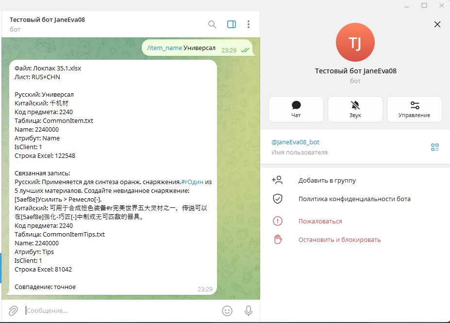

# MCP-помощник по игровой локализации

Telegram-бот для QA: находит китайский оригинал по игровому русскому переводу и наоборот, код предмета по названию или описанию и название с описанием по коду. Сервер и SQLite работают локально; ответы сохраняют исходные тексты, теги, атрибуты и номер строки Excel.

**Домашнее задание VPf08 «MCP (Model Context Protocol)»**, курс «Профессия вайб-кодер», модуль 7. [Отчёт и результаты проверки](HOMEWORK.md) · [Короткий текст для сдачи](SUBMISSION.md) · [Скриншоты](docs/screenshots/README.md)

## Проверено

- Импорт рабочего Excel: **699 154 записи**; SQLite quick_check: ok.
- **20 автоматических тестов** прошли, включая настоящий MCP HTTP-сервер.
- Реальный Telegram-прогон: поиск в обе стороны, по названию/описанию, обратный поиск по коду, одинаковые названия, уточнение и продолжение запроса обычным языком.
- Реальная модель на прогоне: gpt-6-luna через aiprimetech.io. Провайдер и модель настраиваются в локальном .env.
- Нажатие «Ещё» вручную не подтверждалось; прочие ограничения перечислены в [отчёте](HOMEWORK.md#8-ограничения-и-что-не-проверяла-вручную).



## Устройство

```text
Excel → импорт → SQLite
                   ↑
        MCP-сервер (Streamable HTTP)
                   ↑
Telegram → команда или выбор инструмента моделью
                   ↓
       результат базы без перефразирования
```

MCP используется через официальный Python SDK, а не через самодельную имитацию протокола. Telegram-клиент выполняет initialize, получает tools/list и вызывает tools/call.

| Инструмент | Действие |
|---|---|
| search_russian | игровой русский → китайский оригинал и атрибуты |
| search_chinese | китайский оригинал → игровой русский и атрибуты |
| find_item | код предмета по названию или описанию, с уточнением |
| get_item | название и описание по коду предмета |

## Данные и правила

Импортируется только лист **RUS+CHN**:

| Столбец | Значение |
|---|---|
| Id | имя игровой таблицы |
| IsClient | признак клиентской таблицы |
| Name | идентификатор записи |
| ColName | атрибут записи |
| TranslateTextJD | перевод, загружаемый в игру |
| NeedTranslateTextJD_CHN | китайский оригинал |
| NeedTranslateTextJD | исходное поле JD, хранится отдельно |

Оба HJ-столбца исключены. Пустой перевод не подменяется исходным JD. Дополнительно сохраняются номер строки Excel, имя книги, SHA-256 версии и время импорта.

Предметы: название ищется только в CommonItem.txt / ColName=Name, описание — CommonItemTips.txt / ColName=Tips. Связь по одинаковому Name. **Код для выдачи = Name / 1000**, только если делится без остатка; обратное действие — код × 1000. Предметы в самой игре приложение не выдаёт.

Сначала точное совпадение без учёта регистра; если его нет — буквальная подстрока. По пять результатов; связанные строки названия/описания показываются вместе. Дубли сохраняются, текст моделью не исправляется.

Рабочая база и полный Excel не включены. Для воспроизведения есть генератор вымышленных данных той же структуры.

## Быстрый запуск в Windows

Нужен Python 3.12.

```powershell
git clone https://github.com/JaneEva08/localization-mcp-bot.git
cd localization-mcp-bot
py -3.12 -m venv .venv
.\.venv\Scripts\python.exe -m pip install -r requirements-lock.txt
Copy-Item .env.example .env
.\.venv\Scripts\python.exe make_demo.py
```

Заполните локальный .env:

- TELEGRAM_API_TOKEN — токен вашего бота от BotFather.
- OWNER_TELEGRAM_ID — ваш числовой Telegram ID.
- OPENAI_API_KEY — ключ для свободных фраз; явные команды работают и без него.
- OPENAI_BASE_URL — адрес совместимого API; пустое значение использует OpenAI.
- OPENAI_MODEL — модель с Chat Completions function calling; пример по уроку — gpt-4o-mini.
- **LOCALIZATION_DB=data/demo.db** — вымышленная демобаза.

Первый терминал:

```powershell
.\.venv\Scripts\python.exe -m mcp_server.server
```

Второй терминал, из той же папки:

```powershell
.\.venv\Scripts\python.exe -m telegram_bot.bot
```

Если ID владельца неизвестен, сначала оставьте его пустым и отправьте боту /whoami в личном чате. Затем впишите ID и перезапустите бота. До настройки поиск закрыт. Другие пользователи и группы не имеют доступа. Нельзя одновременно запускать два polling-процесса с одним Telegram-токеном.

MCP слушает только http://127.0.0.1:8000/mcp. Для другого порта задайте MCP_PORT и соответствующий MCP_SERVER_URL. Сервер и бот работают, пока включены компьютер и процессы. Для Telegram и LLM нужен интернет. Полная база локальна; модель получает запрос и краткий контекст маршрутизации, а результат отправляется в Telegram напрямую приложением.

### Команды на демоданных

```text
/start
/ru Лунный ключ
/zh 月亮钥匙
/item_name Лунный ключ
/item_desc Открывает лунные врата
/item ключ
название
/id 12
/next
/reset
```

Свободные фразы: «Найди код предмета Лунный ключ» → уточнение → «по названию»; «Покажи предмет с кодом 12».

### Свой Excel

Остановите сервер и бота, затем выполните:

```powershell
.\.venv\Scripts\python.exe import_excel.py "C:\path\localization.xlsx"
```

Для базы по умолчанию LOCALIZATION_DB=data/localization.db. Импорт сохраняет исходник, строит временную базу и заменяет активную только после успешного завершения. Формулы и ошибки в импортируемых полях отклоняются: нужны значения. Разные версии не объединяются. Номер строки относится к импортированной версии Excel.

## Проверки

```powershell
.\.venv\Scripts\python.exe -m unittest discover -v
```

Тесты используют вымышленные Excel/SQLite и подставной LLM-ответ; интеграционный тест поднимает отдельный настоящий MCP-сервер на свободном порту. Ключи и живой Telegram для тестов не нужны. В отчёте эти тесты отделены от ручного прогона.

## Структура

```text
mcp_server/       SQLite-поиск и MCP-сервер
telegram_bot/     бот, MCP-клиент, маршрутизация, форматирование
tests/            unit-тесты, HTTP-интеграция, вымышленные fixtures
docs/screenshots/ реальные скриншоты пользовательской проверки
import_excel.py   импорт RUS+CHN
make_demo.py      генератор демо
settings.py      локальные пути и .env
HOMEWORK.md      отчёт
SUBMISSION.md    текст для поля сдачи
BACKLOG.md       доступ редактора вне ДЗ
```

.env, окружение, Excel и базы исключены из Git. Секреты в репозиторий не добавляйте.

Прежняя версия книжного магазина сохранена в ветке claude/inspiring-lamport-og0ala; актуальный результат VPf08 находится в main. Репозиторий переименован из VPf08 с сохранением истории.

Документация: [MCP SDK 1.x](https://github.com/modelcontextprotocol/python-sdk/tree/v1.x), [OpenAI function calling](https://developers.openai.com/api/docs/guides/function-calling), [aiogram](https://docs.aiogram.dev/en/latest/).
